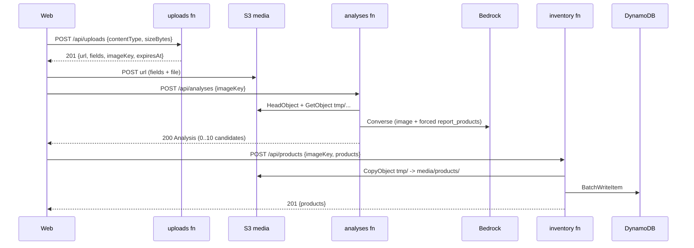

# Design Document: 01-api-bedrock

## Overview

Three Lambda functions, each a thin router over pure services. Contracts from
`@ghoststock/contracts`; AWS access through small adapters so services are unit
testable. ADRs: 0005 (single table), 0007 (Bedrock contract), 0010 (runtime
dependencies).

## Structure

```
services/api/
  src/
    handlers/
      uploads.ts        POST /api/uploads
      analyses.ts       POST /api/analyses
      inventory.ts      /api/products, /api/products/{id}, /api/settings (routeKey switch)
    services/
      uploads.ts        createUploadSlot()
      analyses.ts       analyzeImage()
      products.ts       createProducts(), listProducts(), getProduct(),
                        updateProduct(), deleteProduct()
      settings.ts       getSettings(), updateSettings()
    adapters/
      s3.ts             headImage(), getImageBytes(), copyToMedia(), presignPost()
      dynamo.ts         keys, toItem(), fromItem(), query/put/update/delete helpers
      bedrock.ts        converseWithTool() with retry and timeout
    bedrock/
      prompt.ts         SYSTEM_PROMPT, USER_PROMPT
      tool.ts           REPORT_PRODUCTS_TOOL built from ModelOutputJsonSchema
    lib/
      http.ts           parseJson(), json(), noContent(), withErrors() wrapper
      errors.ts         AppError(code, message, cause?)
      env.ts            zod-validated process.env
      observability.ts  Powertools logger and metrics
      ids.ts            ulid()
  test/                 Vitest unit tests
  package.json, tsconfig.json
```

## Request flow



## Handler contract

```ts
export const handler = withErrors(async (event: APIGatewayProxyEventV2) => {
  const body = parseJson(event, CreateAnalysisRequestSchema); // 400 on failure
  const analysis = await analyzeImage(deps, body.imageKey);
  return json(200, analysis);
});
```

`withErrors` maps `AppError` to `ApiErrorSchema` with `ERROR_HTTP_STATUS`, logs once,
adds `requestId` (`event.requestContext.requestId`), and turns anything else into
`INTERNAL_ERROR`. Responses always set `content-type: application/json` and
`cache-control: no-store`. `parseJson` decodes the body when
`event.isBase64Encoded` is true before parsing.

`inventory.ts` dispatches on `event.routeKey`:
`GET /api/products`, `POST /api/products`, `GET /api/products/{id}`,
`PUT /api/products/{id}`, `DELETE /api/products/{id}`, `GET /api/settings`,
`PUT /api/settings`, and `$default` (any unknown path) which returns
`404 NOT_FOUND` in the standard envelope. Path `id` is validated with `Ulid`.

## Uploads

`createPresignedPost` (`@aws-sdk/s3-presigned-post`) with
`Key = tmp/${ulid()}.${ext}`, `Fields: { "Content-Type": contentType }`,
`Conditions: [["content-length-range", 1, MAX_UPLOAD_BYTES], ["eq", "$Content-Type",
contentType]]`, `Expires: 300`. Extension map: jpeg -> jpg, png -> png, webp -> webp.

Request validation mapping (the only place zod issues are not all `400`): an issue on
`contentType` -> `415 UNSUPPORTED_MEDIA_TYPE`; a `too_big` issue on `sizeBytes` ->
`413 IMAGE_TOO_LARGE`; anything else -> `400 VALIDATION_ERROR`.

## Analyses

1. `HeadObject`: `NotFound` -> `IMAGE_NOT_FOUND`; `ContentLength > MAX_UPLOAD_BYTES`
   -> `IMAGE_TOO_LARGE`; `ContentType` not allowed -> `UNSUPPORTED_MEDIA_TYPE`. Any
   other S3 failure -> `STORAGE_ERROR`.
2. `GetObject` -> `Body.transformToByteArray()` (`NoSuchKey` -> `IMAGE_NOT_FOUND`); the
   byte length is checked against `MAX_UPLOAD_BYTES` again before Bedrock.
3. `converseWithTool` with `toolChoice: { tool: { name: "report_products" } }`,
   `temperature: 0`, `maxTokens: 2000`. The client is created with `maxAttempts: 1`;
   one `AbortController` deadline of 25 s spans every attempt and backoff (each call
   and sleep races the deadline), so the handler always answers with the envelope
   before the 28 s Lambda timeout. The 25 s is one budget for the whole request:
   it is capped at the Lambda remaining time minus 2 s, and the S3 time (client with
   2 attempts, 1 s connect and 5 s request timeouts) is subtracted before Converse;
   no time left -> `MODEL_THROTTLED` without calling Bedrock. A retry happens only if
   the backoff fits in the time left. The Bedrock client uses region `us-east-1`.
4. Retry policy and error mapping exactly as `ai-integration.md`. `ValidationException`
   by message, checked in this order: `/model|access/i` -> `MODEL_UNAVAILABLE`;
   `/image|format|dimension|decode|could not process/i` -> `UNSUPPORTED_MEDIA_TYPE`
   (the photo is the problem, the UI asks for another); otherwise `INTERNAL_ERROR`.
   Any other unlisted Bedrock exception -> `INTERNAL_ERROR`. The Bedrock message is
   logged (capped, `describeCause`), never image bytes.
5. `stopReason` must be `tool_use`; the first `toolUse` block named `report_products`
   is parsed with `ModelOutputSchema.safeParse`; map to `ProductCandidate` with
   `candidateId: ulid()`. `latencyMs` spans the Converse call including retries.
6. Emit `AnalysisLatencyMs` and `CandidateCount` on success, `AnalysisFailed` (single
   metric, dimension `errorCode`) on failures after request validation (a 400 or a
   configuration error is not an analysis failure); log the summary (`analysisId`,
   `imageKey`, `modelId`, `latencyMs`, `candidateCount`, `attempts`); return `Analysis`.

## DynamoDB (ADR 0005)

| Entity | PK | SK | Attributes |
| --- | --- | --- | --- |
| Product | `WS#default` | `PRODUCT#<ulid>` | `entity: "PRODUCT"` + every `Product` field |
| Settings | `WS#default` | `SETTINGS` | `entity: "SETTINGS"`, `lowStockThreshold`, `updatedAt` |

- List: `Query PK = :ws AND begins_with(SK, "PRODUCT#")`, `ScanIndexForward: false`
  (ULIDs sort by time), follow `LastEvaluatedKey` up to 1 000 items.
- Create: `BatchWriteItem` (max 10 items, retry unprocessed items up to 3 times; any
  leftover -> `STORAGE_ERROR`).
- Update: `UpdateItem` with `ConditionExpression attribute_exists(PK)`, expression
  built from the validated partial with placeholders, `ReturnValues: ALL_NEW`.
- Delete: `DeleteItem` with the same condition. `ConditionalCheckFailedException` ->
  `NOT_FOUND`.
- `fromItem` strips `PK`, `SK`, `entity` and parses with `ProductSchema`.
- The shared photo is not deleted with a product (other products may use it).

## Environment

Validated with zod on the first invocation and cached (`lib/env.ts`), inside
`withErrors`, so a misconfigured function answers `500 INTERNAL_ERROR` in the envelope:

| Name | Functions |
| --- | --- |
| `MEDIA_BUCKET` | all |
| `TABLE_NAME` | inventory |
| `BEDROCK_MODEL_ID` | analyses |
| `LOW_STOCK_DEFAULT` | inventory |
| `POWERTOOLS_SERVICE_NAME`, `POWERTOOLS_METRICS_NAMESPACE` (`GhostStock`), `POWERTOOLS_LOG_LEVEL` | all |

## Dependencies (ADR 0010)

Runtime: `@ghoststock/contracts`, `@aws-sdk/client-s3`, `@aws-sdk/s3-presigned-post`,
`@aws-sdk/client-dynamodb`, `@aws-sdk/lib-dynamodb`,
`@aws-sdk/client-bedrock-runtime`, `@aws-lambda-powertools/logger`,
`@aws-lambda-powertools/metrics`, `ulid`, `zod` (same version as contracts). Dev: `@types/aws-lambda`,
`aws-sdk-client-mock`, `vitest`, `typescript`, `@types/node`. Bundled by CDK `NodejsFunction`
(esbuild); this package has `build` = `tsc --noEmit` only. Vitest and `tsc` resolve
`@ghoststock/contracts` to its source (alias and `paths`), so tests need no prior build;
esbuild honours the same tsconfig `paths`, so the Lambda bundle also compiles the
contracts source and no contracts build step is needed before `cdk synth`.

## Testing

- Vitest unit tests per service with `aws-sdk-client-mock`: presign conditions,
  every analysis outcome (empty, invalid tool input, wrong stop reason, throttled
  then success, throttled exhausted, access denied, not found, too large, wrong
  type), create with missing image, create with partial batch failure, update and
  delete not found, settings default.
- `withErrors` tests: envelope shape, status mapping, no stack in body.
- Playwright `e2e/api/*.spec.ts` (project `api`, needs `BASE_URL`): uploads (valid,
  415, 413), real S3 POST of the fixture photo, analysis `@bedrock`, products CRUD
  round trip with cleanup, settings round trip, validation errors. Every body parsed
  with the contract schemas.
