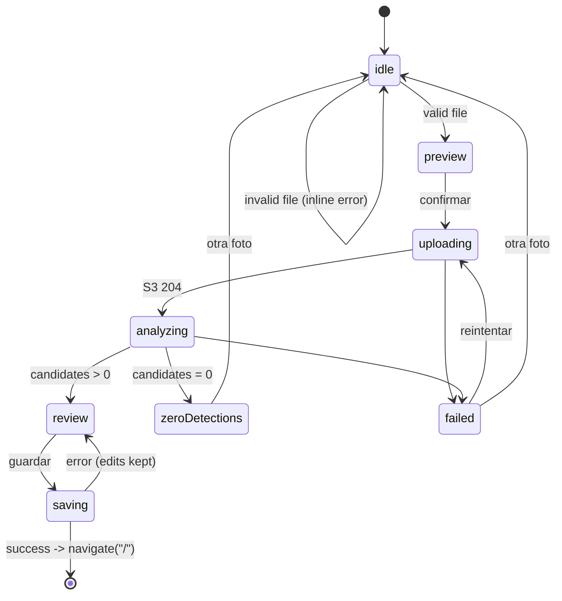

# Design Document: 02-web

## Overview

React 19 SPA built with Vite, Tailwind CSS 4, shadcn/ui (Radix), `motion`
(`motion/react`), TanStack Query and React Router. Same-origin API at `/api`, images
at `/<mediaKey>`. Identity is normative in `ui-identity.md`; this design says where
each piece lives. Majors are the current stable ones at scaffold time, pinned by the
lockfile.

## Structure

```
apps/web/
  index.html
  src/
    main.tsx              bootstraps MSW in DEV only (dynamic import), then renders
    app/
      router.tsx          routes: / , /invocar, /inventario, /ajustes, * (404)
      providers.tsx       QueryClient, Toaster, TooltipProvider, MotionConfig
      shell/              AppShell, Sidebar, TabBar, CommandPalette
    copy/es.ts            every user-visible string and error-code messages
    styles/
      tokens.css          CSS variables from ui-identity.md
      globals.css         Tailwind layers, fonts, grain, glows, fog
    api/
      client.ts           apiFetch<T>(path, init, schema): parses with zod; throws ApiClientError
      uploads.ts          createUpload(), postToS3()
      analyses.ts         createAnalysis()
      products.ts         list, create, update, remove
      settings.ts         get, update
      queries.ts          TanStack Query keys and hooks
    features/
      ritual/             DropZone, CameraButton, resizeImage.ts
      resurrection/       ResurrectionStage, ScanLine, Fog, StatusTicker
      review/             CandidateCard, ConfidenceChip, ReviewToolbar, useReview.ts
      dashboard/          KpiCard, CountUp, ValueByCategoryChart, CategoryDonut,
                          LowStockList, RecentGrid
      inventory/          InventoryTable, InventoryCards, Filters, ProductDrawer,
                          DeleteDialog, exportCsv.ts
      settings/           ThresholdForm
    components/
      ui/                 shadcn generated (button, input, select, sheet, dialog,
                          command, badge, card, skeleton, chart, tooltip, sonner)
      brand/              Logo, GhostEmptyState (inline SVG), GrainOverlay, Glow
      ProductPhoto.tsx    dark frame, object-cover, ghost glyph fallback
    lib/                  cn(), formatCop(), formatNumber(), downloadText()
    mocks/
      handlers.ts         MSW handlers from @ghoststock/contracts fixtures
      scenarios.ts        scenario switch from ?scenario=
      browser.ts
  vite.config.ts          dev server on 5173; serves the MSW worker in dev only;
                          aliases @ghoststock/contracts to its src for dev and build
                          (tsconfig paths do the same, so tsc and Vite agree)
  scripts/assert-no-msw.mjs  build step that fails if MSW reaches dist (11.2)
  components.json         shadcn config
e2e/                      Playwright workspace (scaffold owned by this spec)
  package.json, playwright.config.ts, fixtures/images/, web/*.spec.ts, visual/*.spec.ts
```

## Flow state machine (`/invocar`)



Implemented with `useReducer` in `features/ritual/useInvocation.ts`; the photo blob
and `imageKey` live in the reducer so retries never re-pick the file.

## Image resize

`resizeImage(file)`: `createImageBitmap` (with `imageOrientation: "from-image"`),
scale so the long edge is at most 1568 px, draw on `OffscreenCanvas` (fallback
`canvas`), `convertToBlob({ type: "image/jpeg", quality: 0.85 })`. Keep the original
if it is already within 1568 px and under 1.5 MB. If the result exceeds
`MAX_UPLOAD_BYTES`, re-encode once at quality 0.7.

## API client

- `apiFetch` sends JSON, parses success bodies with the passed schema and error bodies
  with `ApiErrorSchema`; network failures become `ApiClientError("NETWORK")`; error
  bodies that are not a valid envelope (HTTP API 429, CloudFront 5xx, empty) become
  `ApiClientError("UNEXPECTED", { retryable: true })`; `204` resolves to `undefined`
  without parsing.
- Error copy: `copy.errors[code]`, plus `copy.errors.NETWORK`.
- Query keys: `["products"]`, `["settings"]`. Mutations invalidate `["products"]`;
  update uses optimistic cache update with rollback.

## Motion

- `MotionConfig reducedMotion="user"` at the root plus `useReducedMotion()` for loops
  (scan line, fog, breathing circle) so they stop entirely.
- Variants in `features/*/motion.ts`: `rise` (spring stiffness 260, damping 24,
  stagger 0.08, from `y: 24, filter: blur(8px), opacity: 0`), `fadeIn` (250 ms),
  `glowOnce` (ectoplasm shadow pulse 600 ms), count-up via `animate()` on a motion
  value, 900 ms.
- Page transitions: `AnimatePresence` with fade and 8 px rise, 250 ms.

## Visual details

- Dashboard hero: Fraunces 40 to 56 px "Tu almacén", tagline in muted, violet radial
  glow top-left, KPI cards in a 2x2 grid on phones and 4 columns on desktop.
- Charts: horizontal bars for value by category (violet soft), donut for distribution,
  tooltips styled as glass cards, COP formatting.
- Low stock rows: ember left border, "Quedan N" in Geist Mono.
- Inventory table: sticky header, row hover in `--surface-raised`, thumbnails 40 px
  with rounded 8 px frame; cards on phones with photo on top.
- Empty states: `GhostEmptyState` (drifting ghost SVG over shelves, 6 s float loop,
  static under reduced motion).

## MSW

Handlers for every endpoint return contract fixtures. Besides the six spec scenarios, three test-only
scenarios force failures that MSW would otherwise hide from Playwright routing:
`save-error` (POST products 500 `STORAGE_ERROR`), `products-error` (GET products 500
`INTERNAL_ERROR`) and `mutation-error` (PUT/DELETE products and PUT settings 500
`STORAGE_ERROR`). `throttled` answers the analysis with a bare HTTP API 429 body (not
an envelope). In dev, `/media/products/*` serves a fixture photo (Vite middleware). `scenarios.ts` reads
`?scenario=` once and stores it in `sessionStorage` so navigation keeps it.
Scenario `happy` simulates 2.5 s analysis latency so the resurrection is visible.
`postToS3` is intercepted (any `*.amazonaws.com` POST returns 204).

## Playwright (ADR 0009)

`e2e/playwright.config.ts` defines all projects from day one so 01 and 03 only add
spec files:

| Project | testDir | use |
| --- | --- | --- |
| `web-desktop` | `web` | `baseURL http://localhost:5173`, 1440x900 |
| `web-mobile` | `web` | Pixel 7 device |
| `visual` | `visual` | 1440x900 and Pixel 7, `toHaveScreenshot` |
| `api` | `api` | `baseURL process.env.BASE_URL` |
| `smoke` | `smoke` | `baseURL process.env.BASE_URL` |

The `visual` project captures both viewports: each visual spec loops over
`visual/viewports.ts` (1440x900 and Pixel 7) with `test.use` per describe block.
`PW_CHANNEL` (for example `chrome`) optionally runs every project on an installed
browser instead of the downloaded Chromium.

`webServer` is defined as `process.env.BASE_URL ? undefined : { command: "pnpm --filter @ghoststock/web
dev", url: "http://localhost:5173", reuseExistingServer: !process.env.CI }`, so
`--project=api` and `--project=smoke` (which require `BASE_URL`) never boot Vite. The
e2e workspace has scripts per project and no `test` script.
Specs: `ritual.spec.ts`, `resurrection.spec.ts`, `review.spec.ts`,
`dashboard.spec.ts`, `inventory.spec.ts`, `settings.spec.ts`, `a11y.spec.ts`,
`motion.spec.ts`. Test titles carry the criterion id, e.g. `[02 4.4]`.

## Dependencies

Runtime: `react`, `react-dom`, `react-router`, `@tanstack/react-query`, `motion`,
`sonner`, `cmdk`, `recharts`, Radix packages pulled by shadcn, `lucide-react`,
`clsx`, `tailwind-merge`, `class-variance-authority`, `@fontsource-variable/fraunces`,
`@fontsource-variable/geist`, `@fontsource-variable/geist-mono`,
`@ghoststock/contracts`. Dev: `vite`, `@vitejs/plugin-react`, `tailwindcss`,
`@tailwindcss/vite`, `msw`, `vitest`, `@testing-library/react`, `typescript`.
e2e workspace: `@playwright/test`, `@axe-core/playwright`, `@ghoststock/contracts`.
