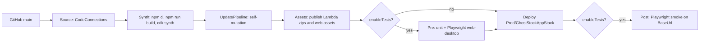

# Design Document: 03-infra-pipeline

## Overview

Two stacks. `GhostStockPipelineStack` (deployed once by hand) builds and deploys stage
`Prod`, which holds a single `GhostStockAppStack` with every runtime resource. One app
stack avoids cross-stack cycles between buckets, OAC policies and the distribution
(ADR 0008).

## Structure

```
infra/
  bin/ghoststock.ts          load + validate config, PipelineStack, cdk-nag aspects
  lib/
    config.ts                readConfig(app): InfraConfig (InfraConfigSchema)
    pipeline-stack.ts        GhostStockPipelineStack
    app-stage.ts             GhostStockAppStage (exposes baseUrl CfnOutput)
    app-stack.ts             GhostStockAppStack
    constructs/
      media-bucket.ts        MediaBucket (lifecycle, CORS POST)
      api-function.ts        ApiFunction (NodejsFunction defaults + LogGroup)
      frontend.ts            Frontend (web bucket, distribution, spa function,
                             headers policy, BucketDeployment)
    functions/spa-rewrite.js CloudFront Function source
    nag.ts                   suppressions with reasons, in one place
  test/*.test.ts             Vitest + assertions
  cdk.json, package.json, tsconfig.json, vitest.config.ts
```

## Pipeline



```ts
// Local `cdk synth`, `cdk diff` and the tests run without deploy-time context, so a
// missing connectionArn uses a placeholder and adds a warning annotation (a pipeline
// deployed with it fails at its source stage; nothing else is affected).
const connectionArn = cfg.connectionArn ?? PLACEHOLDER_CONNECTION_ARN;
const source = pipelines.CodePipelineSource.connection(cfg.repo, cfg.branch, {
  connectionArn,
});
const synth = new pipelines.ShellStep("Synth", {
  input: source,
  env: { CONNECTION_ARN: connectionArn, BUDGET_EMAIL: cfg.budgetEmail ?? "" },
  commands: [
    "npm ci",
    "npm run build",
    "cd infra && npx cdk synth -c connectionArn=$CONNECTION_ARN -c budgetEmail=$BUDGET_EMAIL",
  ],
  primaryOutputDirectory: "infra/cdk.out",
});
const pipeline = new pipelines.CodePipeline(this, "Pipeline", {
  pipelineName: "GhostStock",
  selfMutation: true,
  synth,
  codeBuildDefaults: { buildEnvironment: { buildImage: NODE22_IMAGE } },
});
const prod = new GhostStockAppStage(this, "Prod", { env, config: cfg });
pipeline.addStage(prod, cfg.enableTests ? {
  pre: [new pipelines.ShellStep("Test", { input: source, commands: [
    "npm ci", "npm run build", "npm test",
    "npx playwright install --with-deps chromium",
    "npm run test:web -w @ghoststock/e2e -- --project=web-desktop",
  ]})],
  post: [new pipelines.ShellStep("Smoke", {
    input: source,
    envFromCfnOutputs: { BASE_URL: prod.baseUrl },
    commands: ["npm ci", "npm run build -w @ghoststock/contracts",
               "npx playwright install --with-deps chromium",
               "npm run test:smoke -w @ghoststock/e2e"],
  })],
} : undefined);
```

`NODE22_IMAGE`: the managed CodeBuild image whose runtime list includes Node.js 22,
selected and pinned in task 2 (verified against the CodeBuild docs, not assumed).
`connectionArn` is used only by the pipeline stack; the app stage never reads it.
Every ShellStep gets `input: source` explicitly: the synth output only contains
`infra/cdk.out`, and the test steps need the whole repository. `npm run build` runs
before tests because contracts export `dist/` and `BucketDeployment` needs
`apps/web/dist`.

## App stack

| Resource | Key settings |
| --- | --- |
| Media bucket | BPA all, SSE-S3, enforceSSL, `ObjectOwnership.BUCKET_OWNER_ENFORCED`, lifecycle `tmp/` 1 day, abort multipart 1 day, CORS `[{ allowedMethods: [POST], allowedOrigins: ["*"], allowedHeaders: ["*"], maxAge: 3000 }]`, `RemovalPolicy.DESTROY` + `autoDeleteObjects` (demo) |
| Web bucket | same hardening, no CORS, no lifecycle, DESTROY + autoDelete |
| Table | `PK` / `SK` strings, PAY_PER_REQUEST, AWS_MANAGED, PITR on, DESTROY (demo) |
| uploads fn | 256 MB, 10 s, env `MEDIA_BUCKET` |
| analyses fn | 1024 MB, 28 s, reserved concurrency 5, env `MEDIA_BUCKET`, `BEDROCK_MODEL_ID` |
| inventory fn | 256 MB, 10 s, env `MEDIA_BUCKET`, `TABLE_NAME`, `LOW_STOCK_DEFAULT` |
| HTTP API | routes per `architecture.md` plus `$default` to inventory, `HttpLambdaIntegration`, default stage throttle 10/5, access log group JSON 14 days |
| Distribution | see below |
| Budget | `CfnBudget` COST MONTHLY `budgetUsd`, ACTUAL 80% and 100% to `budgetEmail`, only if provided |

`ApiFunction` defaults: `runtime NODEJS_22_X`, `architecture ARM_64`,
`bundling { minify: true, sourceMap: true, target: "node22", format: OutputFormat.ESM,
mainFields: ["module", "main"], externalModules: [], banner: "import { createRequire }
from 'module'; const require = createRequire(import.meta.url);" }`, `projectRoot` repo
root, `depsLockFilePath` root `package-lock.json`, explicit `LogGroup` (14 days,
DESTROY), Powertools env. `externalModules: []` bundles our pinned SDK clients
(including `@aws-sdk/s3-presigned-post`, which the runtime does not ship) instead of
relying on the runtime's SDK; the banner lets CommonJS dependencies `require` inside
the ESM bundle.

IAM per function (explicit `PolicyStatement`s, no broad grants):
- uploads: `s3:PutObject` on `${mediaBucket.bucketArn}/tmp/*`.
- analyses: `s3:GetObject` on `.../tmp/*`; `s3:ListBucket` on the bucket ARN with
  `StringLike s3:prefix tmp/*`; `bedrock:InvokeModel` on
  `arn:aws:bedrock:${region}:${account}:inference-profile/${modelId}` and
  `arn:aws:bedrock:*::foundation-model/${modelId without the "us." prefix}`.
- inventory: DynamoDB actions from `security.md` on the table ARN; `s3:GetObject` on
  `.../tmp/*`; `s3:ListBucket` with the same `tmp/*` prefix condition; `s3:PutObject`
  on `.../media/products/*`.

`s3:ListBucket` makes S3 return 404 (not 403) for a missing key, which is how
`IMAGE_NOT_FOUND` is detected.

## Distribution (ADR 0006)

```ts
const apiDomain = Fn.select(2, Fn.split("/", httpApi.apiEndpoint));
new cloudfront.Distribution(this, "Distribution", {
  defaultRootObject: "index.html",
  defaultBehavior: {
    origin: S3BucketOrigin.withOriginAccessControl(webBucket),
    viewerProtocolPolicy: REDIRECT_TO_HTTPS,
    functionAssociations: [{ function: spaRewrite, eventType: VIEWER_REQUEST }],
    responseHeadersPolicy: headers,
  },
  additionalBehaviors: {
    "/api/*": { origin: new HttpOrigin(apiDomain), allowedMethods: ALLOW_ALL,
                cachePolicy: CACHING_DISABLED,
                originRequestPolicy: ALL_VIEWER_EXCEPT_HOST_HEADER,
                viewerProtocolPolicy: HTTPS_ONLY, responseHeadersPolicy: headers },
    "/media/*": { origin: S3BucketOrigin.withOriginAccessControl(mediaBucket),
                  cachePolicy: CACHING_OPTIMIZED, viewerProtocolPolicy: REDIRECT_TO_HTTPS,
                  responseHeadersPolicy: headers },
  },
  minimumProtocolVersion: TLS_V1_2_2021,
  httpVersion: HTTP2_AND_3,
});
```

Only keys under `media/` are reachable because CloudFront forwards the path as the
key; `tmp/` objects are never addressable through the distribution.
`spa-rewrite.js`: if the URI has no file extension and does not start with `/api/` or
`/media/`, set it to `/index.html`.

## cdk-nag suppressions (expected, each with reason in `nag.ts`)

- `AwsSolutions-S1` bucket access logs: demo cost and scope.
- `AwsSolutions-CFR1`, `CFR2` geo restriction and WAF: public demo, throttling and
  budget used instead.
- `AwsSolutions-CFR4` only if the default certificate forces TLSv1 on the default
  domain.
- `AwsSolutions-APIG4` no authorizer: single-workspace demo by product decision.
- `AwsSolutions-IAM4`, `IAM5` for CDK-managed helper roles (BucketDeployment,
  autoDeleteObjects, pipeline) and the `foundation-model/*` region wildcard.
- `AwsSolutions-L1` for CDK helper Lambdas whose runtime CDK controls.

## Tests

Vitest with `Template.fromStack`, context `aws:cdk:bundling-stacks: []` to skip
esbuild in tests. Assertions: bucket hardening and lifecycle and CORS; table keys and
PITR; each function runtime, architecture, timeout, memory, concurrency, env; each
role policy matches the IAM table exactly, including the `s3:ListBucket` prefix
condition; `ApiFunction` bundling has `externalModules: []` and the ESM banner;
missing `connectionArn` synthesizes with a warning; HTTP API routes, throttling, no CORS;
distribution behaviors, OAC, function association, no custom error responses; CSP
contains the media bucket domain; `BucketDeployment` with invalidation; budget only
when email given; pipeline `selfMutation`, synth env vars, test steps only when
`enableTests`, each with the source as input; config validation errors; `Annotations` has no cdk-nag errors.
