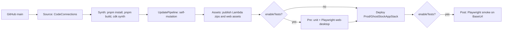

# Design Document: 03-infra-pipeline

## Overview

Two stacks. `GhostStockPipelineStack` (deployed once by hand) builds and deploys stage
`Prod`, which holds a single `GhostStockAppStack` with every runtime resource. One app
stack avoids cross-stack cycles between buckets, OAC policies and the distribution
(ADR 0008).

## Structure

```
infra/
  bin/ghoststock.ts          new App, buildGhostStockApp(app), synth
  lib/
    app.ts                   buildGhostStockApp: config, PipelineStack, cdk-nag
                             aspect on the pipeline stack (shared with tests)
    config.ts                readConfig(node): InfraConfig (InfraConfigSchema)
    paths.ts                 repo root, handlers dir, web dist, lockfile, api tsconfig
    pipeline-stack.ts        GhostStockPipelineStack
    app-stage.ts             GhostStockAppStage (exposes baseUrl CfnOutput)
    app-stack.ts             GhostStockAppStack
    constructs/
      media-bucket.ts        MediaBucket (lifecycle, CORS POST)
      api-function.ts        ApiFunction (NodejsFunction defaults + LogGroup)
      frontend.ts            Frontend (web bucket, distribution, spa function,
                             headers policy, BucketDeployment)
    functions/spa-rewrite.js CloudFront Function source
    nag.ts                   suppressions with reasons, in one place
  test/*.test.ts             Vitest + assertions
  test/fixtures/             stand-in handlers and web dist for tests
  cdk.json, package.json, tsconfig.json, vitest.config.ts
```

## Pipeline



```ts
// Local `cdk synth`, `cdk diff` and the tests run without deploy-time context, so a
// missing connectionArn uses a placeholder and adds a warning annotation (a pipeline
// deployed with it fails at its source stage; nothing else is affected).
const source = pipelines.CodePipelineSource.connection(cfg.repo, cfg.branch, {
  connectionArn: cfg.connectionArn ?? PLACEHOLDER_CONNECTION_ARN,
});
const synth = new pipelines.ShellStep("Synth", {
  input: source,
  // The placeholder is never persisted: an empty value means "not set" on the next run.
  env: { CONNECTION_ARN: cfg.connectionArn ?? "", BUDGET_EMAIL: cfg.budgetEmail ?? "" },
  commands: [
    "corepack enable",
    "pnpm install --frozen-lockfile",
    "pnpm build",
    'cd infra && pnpm exec cdk synth -c "connectionArn=$CONNECTION_ARN" -c "budgetEmail=$BUDGET_EMAIL"',
  ],
  primaryOutputDirectory: "infra/cdk.out",
});
const pipeline = new pipelines.CodePipeline(this, "Pipeline", {
  pipelineName: "GhostStock",
  pipelineType: PipelineType.V2,
  selfMutation: true,
  crossAccountKeys: false, // single account, no KMS key cost
  synth,
  codeBuildDefaults: {
    buildEnvironment: { buildImage: LinuxBuildImage.STANDARD_8_0 },
    partialBuildSpec: BuildSpec.fromObject({
      phases: { install: { "runtime-versions": { nodejs: "22" } } },
    }),
  },
});
const prod = new GhostStockAppStage(this, "Prod", { env, config: cfg });
pipeline.addStage(prod, cfg.enableTests ? {
  pre: [new pipelines.ShellStep("Test", { input: source, commands: [
    "corepack enable", "pnpm install --frozen-lockfile", "pnpm build", "pnpm test",
    "pnpm --filter @ghoststock/e2e exec playwright install --with-deps chromium",
    "pnpm --filter @ghoststock/e2e exec playwright test --project=web-desktop",
  ]})],
  post: [new pipelines.ShellStep("Smoke", {
    input: source,
    envFromCfnOutputs: { BASE_URL: prod.baseUrl },
    commands: ["corepack enable", "pnpm install --frozen-lockfile",
               "pnpm --filter @ghoststock/contracts build",
               "pnpm --filter @ghoststock/e2e exec playwright install --with-deps chromium",
               "pnpm --filter @ghoststock/e2e test:smoke"],
  })],
} : undefined);
```

Build image: `aws/codebuild/standard:8.0` (Ubuntu 24.04). The CodeBuild "Available
runtimes" table lists Node.js 22 for it, and Ubuntu supports `playwright install
--with-deps`; `runtime-versions: nodejs: 22` pins the runtime in every project's
buildspec. The Test step calls `playwright test --project=web-desktop` directly
because the e2e `test:web` script already selects both web projects. Every step starts with `corepack enable` (bundled with Node.js 22) so the exact pnpm
version from the root `packageManager` field is used; our steps never invoke npm. The
steps CDK Pipelines generates (self-mutation, asset publishing) install the CDK CLI
and `cdk-assets` with `npm install -g`; both are pinned (`cliVersion` = the infra
`aws-cdk` devDependency, `cdkAssetsCliVersion`) so a release cannot change the
pipeline without a commit.
`connectionArn` is used only by the pipeline stack; the app stage never reads it.
Every ShellStep gets `input: source` explicitly: the synth output only contains
`infra/cdk.out`, and the test steps need the whole repository. `pnpm build` runs
before tests because contracts export `dist/` and `BucketDeployment` needs
`apps/web/dist`.

### Manual teardown stage (ADR 0014, supersedes 0013)

After Prod the pipeline has a `Teardown` wave: `ApproveTeardown` (manual approval)
then `DestroyApp` (CodeBuild step, runs only after the approval). Every run waits at
the approval; nobody has to answer it, it expires after 7 days. Approving (console or
`put-approval-result`, see `docs/deployment.md` step 8) runs `aws cloudformation
delete-stack` on the app stack and waits for `stack-delete-complete`. Besides
CodeBuild's own logs and reports, the step role may only
`cloudformation:DeleteStack` and `DescribeStacks` on the app stack and
`iam:PassRole` the CDK bootstrap CloudFormation execution role (condition
`iam:PassedToService = cloudformation.amazonaws.com`). Buckets empty themselves
(`autoDeleteObjects`) and every app resource uses `RemovalPolicy.DESTROY`; only the
implicit log group of the `autoDeleteObjects` helper Lambda remains, together with the
pipeline, its artifacts bucket and logs. A V2 pipeline with no executions costs
nothing, and starting the pipeline redeploys the app.

## App stack

| Resource | Key settings |
| --- | --- |
| Media bucket | BPA all, SSE-S3, enforceSSL, `ObjectOwnership.BUCKET_OWNER_ENFORCED`, lifecycle `tmp/` 1 day, abort multipart 1 day, CORS `[{ allowedMethods: [POST], allowedOrigins: ["*"], allowedHeaders: ["*"], maxAge: 3000 }]`, `RemovalPolicy.DESTROY` + `autoDeleteObjects` (demo) |
| Web bucket | same hardening, no CORS, no lifecycle, DESTROY + autoDelete |
| Table | `TableV2`, `PK` / `SK` strings, on demand, `TableEncryptionV2.awsManagedKey()` (KMS `aws/dynamodb`), PITR on, DESTROY (demo) |
| uploads fn | 256 MB, 10 s, env `MEDIA_BUCKET` |
| analyses fn | 1024 MB, 28 s, no reserved concurrency (account quota 10), env `MEDIA_BUCKET`, `BEDROCK_MODEL_ID` |
| inventory fn | 256 MB, 10 s, env `MEDIA_BUCKET`, `TABLE_NAME`, `LOW_STOCK_DEFAULT` |
| HTTP API | routes per `architecture.md` plus `$default` to inventory, `HttpLambdaIntegration`, default stage throttle 10/5, access log group JSON 14 days |
| Distribution | see below |
| Budget | `CfnBudget` COST MONTHLY `budgetUsd`, ACTUAL 80% and 100% to `budgetEmail`, only if provided; otherwise a `ghoststock:no-budget` synth warning |
| BucketDeployment | explicit 14 day `LogGroup` (DESTROY) so the helper's logs leave with the stack |

`infra/cdk.json` carries the CDK recommended feature flags (from
`aws-cdk-lib/recommended-feature-flags.json`), set before the first deploy because
adding them later can replace resources. Among other effects, error annotations fail
synth and ARNs use the literal `aws` partition.

`ApiFunction` defaults: `runtime NODEJS_22_X`, `architecture ARM_64`,
`bundling { minify: true, sourceMap: true, target: "node22", tsconfig:
"services/api/tsconfig.json", format: OutputFormat.ESM, mainFields: ["module",
"main"], externalModules: [], banner: "import { createRequire } from 'module'; const
require = createRequire(import.meta.url);" }`, `projectRoot` repo root,
`depsLockFilePath` root `pnpm-lock.yaml`, explicit `LogGroup` (14 days, DESTROY), env
`POWERTOOLS_SERVICE_NAME` (function name), `POWERTOOLS_METRICS_NAMESPACE` (`GhostStock`),
`POWERTOOLS_LOG_LEVEL` (`INFO`), `NODE_OPTIONS=--enable-source-maps`.
`externalModules: []` bundles our pinned SDK clients (including
`@aws-sdk/s3-presigned-post`, which the runtime does not ship) instead of relying on
the runtime's SDK; the banner lets CommonJS dependencies `require` inside the ESM
bundle. The api tsconfig maps `@ghoststock/contracts` to its source, so bundling needs
no contracts build. CDK runs `pnpm exec esbuild` from `projectRoot`, so `esbuild` is a
root devDependency (its install script allowed in `pnpm-workspace.yaml`).

IAM per function (explicit `PolicyStatement`s, no broad grants):
- uploads: `s3:PutObject` on `${mediaBucket.bucketArn}/tmp/*`.
- analyses: `s3:GetObject` on `.../tmp/*`; `s3:ListBucket` on the bucket ARN with
  `StringLike s3:prefix tmp/*`; `bedrock:InvokeModel` on
  `arn:aws:bedrock:${region}:${account}:inference-profile/${modelId}`, and on
  `arn:aws:bedrock:*::foundation-model/${modelId without the "us." prefix}` only with
  `StringEquals bedrock:InferenceProfileArn = <that profile ARN>` (no direct model
  calls).
- inventory: DynamoDB actions from `security.md` on the table ARN; `s3:GetObject` on
  `.../tmp/*`; `s3:ListBucket` with the same `tmp/*` prefix condition; `s3:PutObject`
  on `.../media/products/*`.

`s3:ListBucket` makes S3 return 404 (not 403) for a missing key, which is how
`IMAGE_NOT_FOUND` is detected.

## Distribution (ADR 0006)

```ts
const apiDomain = Fn.select(2, Fn.split("/", httpApi.apiEndpoint));
new cloudfront.Distribution(this, "Distribution", {
  defaultRootObject: "index.html",
  defaultBehavior: {
    origin: S3BucketOrigin.withOriginAccessControl(webBucket),
    viewerProtocolPolicy: REDIRECT_TO_HTTPS,
    functionAssociations: [{ function: spaRewrite, eventType: VIEWER_REQUEST }],
    responseHeadersPolicy: headers,
  },
  additionalBehaviors: {
    "/api/*": { origin: new HttpOrigin(apiDomain), allowedMethods: ALLOW_ALL,
                cachePolicy: CACHING_DISABLED,
                originRequestPolicy: ALL_VIEWER_EXCEPT_HOST_HEADER,
                viewerProtocolPolicy: HTTPS_ONLY, responseHeadersPolicy: headers },
    "/media/*": { origin: S3BucketOrigin.withOriginAccessControl(mediaBucketRef),
                  cachePolicy: CACHING_OPTIMIZED, viewerProtocolPolicy: REDIRECT_TO_HTTPS,
                  responseHeadersPolicy: headers },
  },
  httpVersion: HTTP2_AND_3,
});
```

No `minimumProtocolVersion`: with the default `*.cloudfront.net` certificate CloudFront
fixes the viewer security policy and CDK ignores the prop (synth warning). TLS 1.2
minimum is set together with a custom domain certificate (requirement 6.4).

Only keys under `media/` are reachable because CloudFront forwards the path as the
key. Defense in depth: the media origin uses a `Bucket.fromBucketAttributes` reference,
so CDK does not write its default OAC grant on `bucket/*` (its warning is
acknowledged), and the stack adds one bucket policy statement instead: principal
`cloudfront.amazonaws.com`, `s3:GetObject` on `media/products/*`, condition
`AWS:SourceArn` = the distribution ARN. `tmp/` uploads stay unreadable even if routing
changes.
`spa-rewrite.js`: if the URI has no file extension and does not start with `/api/` or
`/media/`, set it to `/index.html`.

## cdk-nag suppressions (each with reason in `nag.ts`)

cdk-nag `2.38.x` (`AwsSolutionsChecks` aspect, `NagSuppressions` with `appliesTo`
regexes). cdk-nag 3 moved to CDK validation plugins whose acknowledgements must match
each finding id exactly, including generated logical ids, so 2.x is pinned. The aspect
is added to the pipeline stack (`lib/app.ts`) and inside `GhostStockAppStage`: CDK
Pipelines synthesizes the stage during `buildPipeline()`, before any aspect added to
the App would exist, so an App-level aspect never checks the app stack.

- `AwsSolutions-S1` bucket access logs (web, media, pipeline artifacts): demo cost.
- `AwsSolutions-CFR1`, `CFR2`, `CFR3` geo restriction, WAF, distribution logs: public
  demo, throttling and budget used instead.
- `AwsSolutions-CFR4` the default certificate fixes the TLS policy (see above).
- `AwsSolutions-APIG4` no authorizer: single-workspace demo by product decision.
- `AwsSolutions-IAM4` `AWSLambdaBasicExecutionRole` on our functions and the
  BucketDeployment helper (logs only).
- `AwsSolutions-IAM5` narrowed with `appliesTo`: our `tmp/*` and `media/products/*`
  object ARNs and the `foundation-model/*` region wildcard; BucketDeployment's S3
  wildcards and `cloudfront:CreateInvalidation` on `*`; CDK Pipelines roles (artifacts
  bucket, CodeBuild logs and reports, bootstrap roles). `Resource::*` in the pipeline
  is suppressed by path only on the asset FileRole and the SelfMutation role, so a `*`
  added anywhere else fails synth.
- `AwsSolutions-CB4` CodeBuild without a KMS key (single account, no
  `crossAccountKeys`).
- `AwsSolutions-L1` our functions (runtime pinned to 22 by this spec) and CDK helper
  Lambdas.

## Tests

Vitest with `Template.fromStack`, context `aws:cdk:bundling-stacks: []` to skip
esbuild in tests, and asset paths (`AppAssetPaths`) pointed at `test/fixtures` so tests
need neither the api handlers nor a web build. Assertions: bucket hardening and
lifecycle and CORS; table keys and PITR; each function runtime, architecture, timeout,
memory, concurrency, env and its own 14 day log group; each role policy matches the
IAM table exactly, including the `s3:ListBucket` prefix condition and the Bedrock
inference profile condition; `ApiFunction` source declares `externalModules: []` and
the ESM banner (bundling options never reach the template; `cdk synth` exercises the
real bundle); missing `connectionArn` or `budgetEmail` synthesizes with a warning;
HTTP API routes, the function behind every route including `$default`, throttling, no
CORS; distribution behaviors (redirect vs HTTPS only), OAC, function association, no
custom error responses; the media bucket lets CloudFront read only `media/products/*`;
CSP contains the media bucket domain; `BucketDeployment` with invalidation; budget only
when email given; pipeline `selfMutation`, synth env vars, test steps only when
`enableTests`, each with the source artifact as input, pinned CDK CLI and
`cdk-assets`; config validation errors; `Annotations` has no cdk-nag errors; the Prod
stage fails synth on an unhardened bucket (proves its aspect runs); every suppression
has a reason; the SPA rewrite function source is run in a VM; the teardown project
exists, is not part of the pipeline and its role is limited to the app stack.

Smoke (`e2e/smoke/smoke.spec.ts`, Requirement 10.2) runs against `BASE_URL` with one
worker (stage throttling; a `429` is retried with backoff): the dashboard renders in
Spanish, an SPA deep link returns `index.html`, `GET /api/products` and
`GET /api/settings` parse with the contract schemas, `POST /api/uploads` returns a
contract-valid slot whose S3 origin is in the CSP `connect-src`, HSTS, CSP,
`X-Frame-Options: DENY`, `nosniff` and the referrer policy are present, and an unknown
`/api` path returns the JSON `NOT_FOUND` envelope. It never calls Bedrock and never
creates products (an upload slot only signs a POST).
