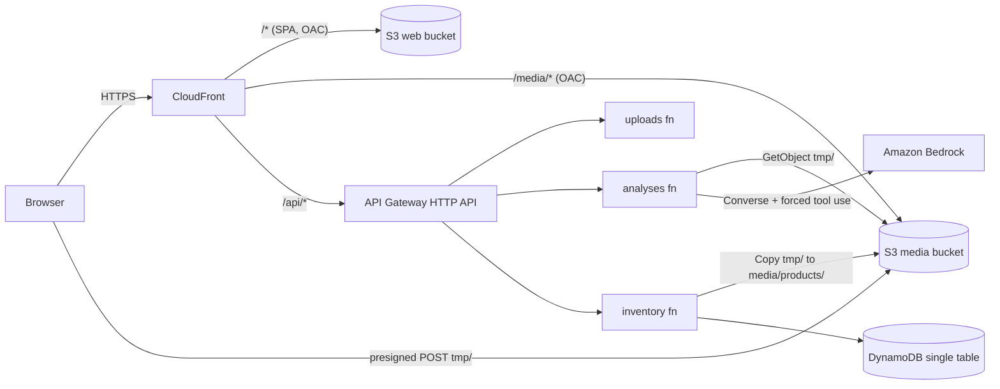

# Architecture

Decisions and their reasons: #[[file:docs/adr/README.md]]

## Repository layout

pnpm workspaces monorepo (ADR 0011), TypeScript everywhere (ADR 0002). Node.js 22
(`.nvmrc`). Internal dependencies use `workspace:*`; never npm or npx.

```
packages/contracts/  zod 4 schemas, inferred types, fixtures       spec 00-contracts
services/api/        Lambda handlers, Bedrock, DynamoDB, S3        spec 01-api-bedrock
apps/web/            React SPA (Vite, Tailwind, shadcn/ui, Motion) spec 02-web
infra/               CDK v2 app: AppStack + self-mutating pipeline spec 03-infra-pipeline
e2e/                 Playwright: web/ (02), api/ (01), smoke/ (03) ADR 0009
```

## Runtime



One origin for the user (ADR 0006): no CORS on the API, no API URL baked into the
build, images served from the same domain.

## Endpoints (contracts in `packages/contracts`)

| Method | Path | Function |
| --- | --- | --- |
| POST | `/api/uploads` | uploads |
| POST | `/api/analyses` | analyses |
| GET, POST | `/api/products` | inventory |
| GET, PUT, DELETE | `/api/products/{id}` | inventory |
| GET, PUT | `/api/settings` | inventory |
| any | `$default` (unknown path) | inventory, returns `404 NOT_FOUND` envelope |

CSV export and dashboard stats are computed in the browser from the product list
(no extra Lambda, ADR 0005).

## Key principles

- **Contracts first.** Every shape crossing a boundary lives in `packages/contracts`.
  No workspace redefines one.
- **Thin handlers.** Parse with zod, call a pure service, map to the error catalog.
- **Honest AI.** Structured output via forced tool use, validated with zod; empty is
  valid, invalid is an explicit error (ADR 0007).
- **Single table.** `PK = WS#default`; every read is one Query (ADR 0005).
- **One AppStack** plus the pipeline stack (ADR 0008). Every merge to `main` deploys.
- **Managed and minimal.** No queues, containers, auth providers or extra services.

## Spec lanes and ownership

| Spec | Owns | Unblocked by |
| --- | --- | --- |
| `00-contracts` | `packages/contracts/**`, `docs/api.md` | nothing |
| `01-api-bedrock` | `services/api/**`, `e2e/api/**` | 00 merged |
| `02-web` | `apps/web/**`, `e2e/web/**`, `e2e/visual/**`, `e2e/package.json`, `e2e/playwright.config.ts`, `e2e/fixtures/**`, `docs/demo.md` | 00 merged |
| `03-infra-pipeline` | `infra/**`, `e2e/smoke/**`, `docs/deployment.md`, `docs/architecture.md` | 00 merged |

Root files (`package.json`, `.nvmrc`, `.gitignore`) change only in small harness PRs,
except adding `e2e` to the root `workspaces` list in spec 02 task 1.
