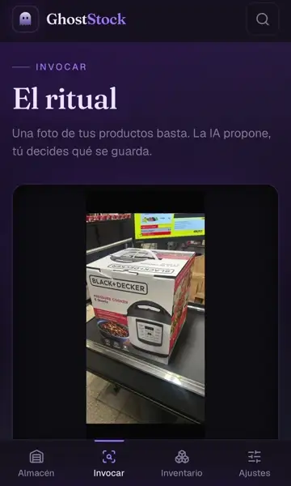
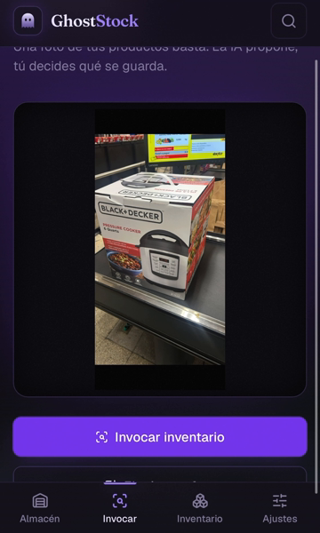
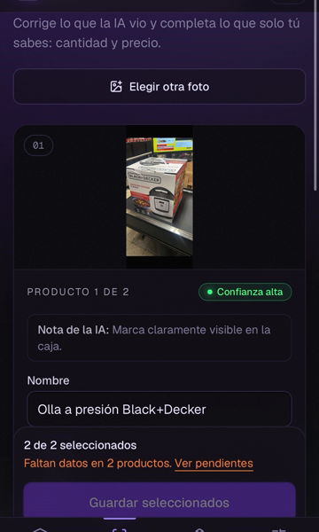
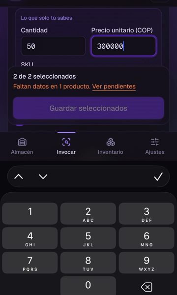
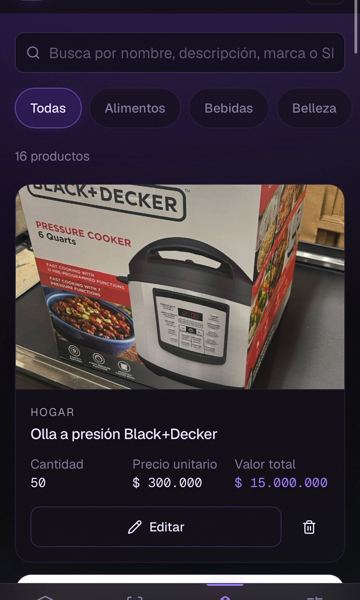
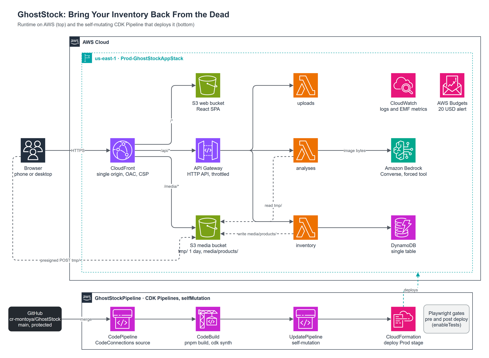

<div align="center">

# GhostStock

**Bring Your Inventory Back From the Dead.**

Take a photo of your shelf. Amazon Bedrock recognizes the products. You confirm quantities and prices. Your warehouse wakes up.

[](LICENSE)


Built in one day and winner at **Kiro Day Medellín 2026**.

</div>

---

## Demo

Photo upload, detected products, review and inventory on a phone, recorded from the deployed app.



<p>
  <a href="docs/media/upload.png"></a>
  <a href="docs/media/detected.png"></a>
  <a href="docs/media/review.png"></a>
  <a href="docs/media/inventory.png"></a>
</p>

## What it does

| Step | What happens |
| --- | --- |
| **The ritual** | Drop or take a photo. The browser downscales it and uploads it straight to S3 with a presigned POST. |
| **The resurrection** | A Lambda sends the image to Amazon Bedrock (Converse API) with one forced tool, `report_products`. |
| **The review** | Candidates rise as editable cards with a confidence level and notes. You add quantity, unit price and an optional SKU. |
| **The awakening** | Products are saved; the dashboard counts up value, units, categories and low stock. |
| **The inventory** | Search, filter by category, edit, delete and export to CSV ready for Excel. |

### Honest AI by design

The model can only answer by filling a strict schema that has **no fields for price, quantity, SKU or barcode**, so it cannot invent them. Every number in the inventory is typed by a person. Zero detections is a valid answer shown as a state, invalid output is rejected whole, and nothing is ever fabricated ([ADR 0007](docs/adr/0007-bedrock-structured-output-and-honest-ai.md)).

## Architecture



- **One public entry point.** A single CloudFront distribution serves the SPA, `/api/*` and `/media/*`. Both buckets are private behind OAC, so the API needs no CORS ([ADR 0006](docs/adr/0006-single-cloudfront-origin.md)).
- **Serverless and minimal.** HTTP API, three Lambda functions on Node.js 22 arm64, one DynamoDB table and Amazon Bedrock. No queues, containers or servers ([ADR 0005](docs/adr/0005-single-table-and-client-side-aggregates.md)).
- **Least privilege.** One IAM role per function with exact actions and resources, cdk-nag `AwsSolutions` with zero open findings, throttling and a cost budget.
- **Self-mutating delivery.** Every merge to `main` runs a CDK Pipeline that builds, updates itself and deploys; Playwright gates run before and after the deploy ([ADR 0008](docs/adr/0008-one-app-stack-and-self-mutating-pipeline.md)).

Editable source: [`docs/diagrams/architecture.drawio`](docs/diagrams/architecture.drawio). Service by service details: [docs/architecture.md](docs/architecture.md).

## How it was built

GhostStock is as much about **how** it was built as about what it does.

**Spec-Driven Development with Kiro.** Kiro wrote the steering and four specs ([`.kiro/specs`](.kiro/specs)) with EARS requirements, design and tasks. Steering loads by context: the web agent gets the visual identity, the infra agent gets the CDK rules ([`.kiro/steering`](.kiro/steering)).

**Adversarial review before code.** Every spec went through a *grill*: an agent whose only job is to break it. The first verdict was DO NOT START because the model could still invent prices. The spec was fixed, an independent reviewer found five more blockers, and only then was code written.

**A harness every tool obeys.**
- [`AGENTS.md`](AGENTS.md) is the single router for Kiro, Claude Code or any other agent; skills and agent briefs live once in [`.agents/`](.agents).
- Git-native gates in [`.agents/hooks/git`](.agents/hooks/git): no commits or pushes to `main`, Conventional Commits, no AI attribution, secret scan, and an ADR gate for architecture changes.
- [ADRs](docs/adr/README.md) and living docs; [`docs/api.md`](docs/api.md) is generated from the contract fixtures.

**Parallel agents, independent evaluators.** Three agents worked in parallel lanes (API, web, infra), each in its own git worktree with path ownership and no overlaps. No builder certified its own work: code, security, QA and visual reviewers ran on every pull request. More than 25 small PRs landed on a trunk-based `main`.

## Stack

| Layer | Technology |
| --- | --- |
| Contracts | zod 4 schemas, types and fixtures shared by every workspace |
| Web | React 19, Vite, Tailwind CSS 4, shadcn/ui, Motion, TanStack Query, MSW |
| API | AWS Lambda (TypeScript), AWS SDK v3, Powertools for AWS Lambda |
| AI | Amazon Bedrock Converse with forced tool use (Amazon Nova Pro, Claude ready) |
| Data | DynamoDB single table, S3 |
| Infra | AWS CDK v2 in TypeScript, CDK Pipelines, CloudFront, cdk-nag |
| Tests | Playwright (web, API, smoke, accessibility, visual) and Vitest |
| Tooling | pnpm workspaces, Kiro, Claude Code |

## Repository layout

```
packages/contracts/   zod schemas, fixtures, stats and CSV helpers (spec 00)
services/api/         Lambda handlers, Bedrock adapter, DynamoDB and S3 (spec 01)
apps/web/             React SPA with the Halloween identity (spec 02)
infra/                CDK app stack and self-mutating pipeline (spec 03)
e2e/                  Playwright projects: web, visual, api, smoke
.kiro/                steering and specs
.agents/              skills, agent briefs and git gates
docs/                 architecture, deployment, API reference, ADRs, demo script
```

## Run it locally

Requires Node.js 22 and pnpm (enabled with `corepack enable`). npm is blocked on purpose ([ADR 0011](docs/adr/0011-pnpm-workspaces.md)).

```sh
pnpm install
pnpm build
pnpm --filter @ghoststock/web dev
```

The web app runs on `http://localhost:5173` with mocked APIs (MSW). Add `?scenario=zero-candidates`, `model-error`, `throttled` or `empty` to the URL to see every state.

```sh
pnpm test                                   # unit tests in every workspace
pnpm --filter @ghoststock/e2e test:web      # Playwright on desktop and phone
```

## Deploy from your fork

1. Fork the repository. In [`infra/cdk.json`](infra/cdk.json), set context `repo` to `YOUR_GITHUB_USER/GhostStock` and `branch` to your deployment branch (normally `main`); keep `region` as `us-east-1`.
2. Create an AWS CodeConnections GitHub connection in your account and authorize the GitHub app for **your fork** until the connection is `AVAILABLE`. Supply its ARN as `-c connectionArn=<CONNECTION_ARN>` during the first pipeline deploy; keep account-specific values out of git.
3. Use the default Bedrock profile `us.amazon.nova-pro-v1:0` (Amazon Nova Pro). Ensure your account can invoke it; Anthropic alternatives require the one-time use case form before switching `bedrockModelId` ([ADR 0012](docs/adr/0012-default-model-amazon-nova-pro.md)).
4. Follow [the deployment guide](docs/deployment.md) for bootstrap, permissions, `budgetEmail` and the owner-run first deploy. Afterward, pushes to the configured branch deploy automatically. Merging to this repository's `main` deploys to the maintainer's AWS account.

## Costs and cleanup

Public AWS list prices checked **2026-11-16**, in USD for **us-east-1**, before taxes, credits and free tiers. This is a usage estimate, not a measured bill or a fixed monthly price.

| Component | What you pay for |
| --- | --- |
| [Bedrock Nova Pro](https://aws.amazon.com/bedrock/pricing/) | Standard on-demand input: **$0.80 per million tokens**; output: **$3.20 per million tokens**. Images count toward input usage. |
| [Lambda](https://aws.amazon.com/lambda/pricing/) and [HTTP API](https://aws.amazon.com/api-gateway/pricing/) | Arm compute duration and memory, plus requests; HTTP API starts at **$1 per million requests**. No always-on application server. |
| [DynamoDB](https://aws.amazon.com/dynamodb/pricing/) and [S3](https://aws.amazon.com/s3/pricing/) | On-demand reads/writes, stored inventory, photos, web assets and pipeline artifacts, plus S3 requests. Storage remains billable while idle. |
| [CloudFront](https://aws.amazon.com/cloudfront/pricing/pay-as-you-go/) and [CloudWatch](https://aws.amazon.com/cloudwatch/pricing/) | Viewer requests and data transfer (rates depend on viewer location), log ingestion and retained logs. |
| [CodePipeline V2](https://aws.amazon.com/codepipeline/pricing/) and [CodeBuild](https://aws.amazon.com/codebuild/pricing/) | **$0.002 per billed action-minute**, plus build compute minutes and artifacts. Manual approval waiting time is not billed by CodePipeline. |

**Per-analysis example:** assume one standard Nova Pro call with 2,000 input tokens (photo, prompt and tool schema combined), 500 output tokens, no caching and no retries. Bedrock costs `(2,000 × $0.80 + 500 × $3.20) / 1,000,000 = $0.0032`, or **$3.20 for 1,000 such analyses**. This is the model charge only: add the services above. Image size, number of products, output length and retries change usage. Rates are also published in the [AWS price list for Bedrock in us-east-1](https://pricing.us-east-1.amazonaws.com/offers/v1.0/aws/AmazonBedrock/current/us-east-1/index.json).

`budgetUsd: 20` in [`infra/cdk.json`](infra/cdk.json) configures a **$20 monthly AWS Budget**, created only when `budgetEmail` is supplied. Actual-spend alerts fire at 80% and 100%; this is an account cost budget, **not a spending cap or automatic shutdown**. No budget is created without an alert address.

**Cleanup:** follow [Teardown in the deployment guide](docs/deployment.md#8-teardown-owner-only). Approving the manual `Teardown/ApproveTeardown` stage runs `DestroyApp` and deletes the app, including inventory and photos; it keeps the pipeline and retained artifacts/logs, which may still incur storage costs. [ADR 0014](docs/adr/0014-manual-teardown-stage-after-prod.md) replaces the standalone approach in [ADR 0013](docs/adr/0013-manual-teardown-keeps-the-pipeline.md). To delete everything, use the guide's [full cleanup sequence](docs/deployment.md#delete-everything), including its list of retained resources.

## License

[MIT](LICENSE). Copyright (c) 2026 Cristian Montoya.

## Documentation

| Doc | What it answers |
| --- | --- |
| [docs/architecture.md](docs/architecture.md) | AWS services, responsibilities and known limits |
| [docs/deployment.md](docs/deployment.md) | First deployment and pipeline operation |
| [docs/api.md](docs/api.md) | Every endpoint with example payloads |
| [docs/adr/](docs/adr/README.md) | Why each decision was made |
| [docs/sdd-workflow.md](docs/sdd-workflow.md) | From Kiro spec to merged code |
| [docs/git-workflow.md](docs/git-workflow.md) | Trunk-based flow and git gates |
| [docs/demo.md](docs/demo.md) | The 3 minute demo script |

---

<div align="center">

Made with specs, a strict harness and a little ectoplasm by [Cristian Montoya](https://github.com/cr-montoya).

</div>
