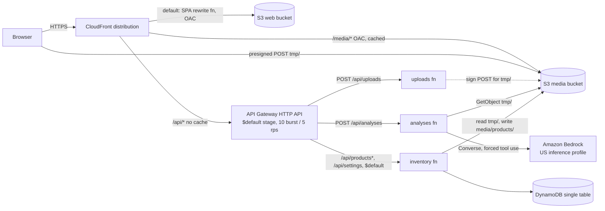
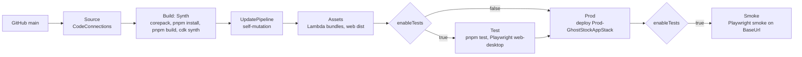

# Architecture

What runs in AWS and how it gets there. Principles, layout and endpoints live in
[`.kiro/steering/architecture.md`](../.kiro/steering/architecture.md); the reasons live
in the [ADRs](adr/README.md). This page matches `infra/` on `main`.

## Runtime

One public entry point ([ADR 0006](adr/0006-single-cloudfront-origin.md)): the SPA,
the API and saved photos share the CloudFront domain, so the API needs no CORS and the
build has no API URL baked in. Only uploads go straight to S3, through a presigned
POST limited to one `tmp/` key, one content type, 3.75 MB and 300 s.

## Delivery pipeline

`GhostStockPipeline` is deployed once by hand ([deployment.md](deployment.md)); after
that every merge to `main` runs this pipeline ([ADR 0008](adr/0008-one-app-stack-and-self-mutating-pipeline.md)).
CodeBuild uses `aws/codebuild/standard:8.0` with Node.js 22 pinned in the buildspec and
pnpm through corepack ([ADR 0011](adr/0011-pnpm-workspaces.md)).

## AWS services and responsibilities

| Service | Resource | Responsibility | Key settings |
| --- | --- | --- | --- |
| CloudFront | distribution, CloudFront Function, response headers policy | Only public entry; SPA routing; security headers | HTTPS (redirect for SPA and media, HTTP rejected on `/api/*`), HTTP/2 and 3, OAC to both buckets, no custom error responses, HSTS, CSP, `X-Frame-Options: DENY` |
| S3 | web bucket | Built SPA (`apps/web/dist`) | private, SSE-S3, TLS only, owner enforced; published by `BucketDeployment` with `/*` invalidation |
| S3 | media bucket | Raw uploads (`tmp/`, deleted after 1 day) and saved photos (`media/products/`) | private, SSE-S3, TLS only, CORS `POST` only; CloudFront (OAC) may read `media/products/*` only |
| API Gateway | HTTP API | Routes `/api/*` to three functions | default stage throttling burst 10 / rate 5, JSON access logs 14 days, no CORS, no authorizer (single-workspace demo) |
| Lambda | `uploads` | Presigned POST for `tmp/<ulid>.<ext>` | Node.js 22 arm64, 256 MB, 10 s; `s3:PutObject` on `tmp/*` |
| Lambda | `analyses` | Bedrock Converse on an uploaded image | 1024 MB, 28 s, no reserved concurrency (account quota 10); read `tmp/*`, list with `tmp/*` prefix, `bedrock:InvokeModel` on the profile, and on its models only through the profile |
| Lambda | `inventory` | Products, settings, unknown-route `NOT_FOUND` | 256 MB, 10 s; table read and write, read `tmp/*`, write `media/products/*` |
| DynamoDB | single table (`PK`, `SK`) | Products and settings ([ADR 0005](adr/0005-single-table-and-client-side-aggregates.md)) | on demand, AWS managed KMS key, point-in-time recovery |
| Bedrock | US cross-region inference profile | Product candidates from a photo ([ADR 0007](adr/0007-bedrock-structured-output-and-honest-ai.md)) | model id from `infra/cdk.json` |
| CloudWatch Logs | one log group per function plus API access logs | Structured logs | 14 day retention |
| AWS Budgets | monthly cost budget | Cost alert | `budgetUsd` (20 USD), email at 80% and 100% actual, only with `budgetEmail` |
| CodePipeline, CodeBuild | `GhostStock` pipeline | Build, self-mutate, deploy, optional tests | V2 pipeline, single account, no cross-account KMS key |

Each function has its own role with exactly the actions in
[`security.md`](../.kiro/steering/security.md). cdk-nag `AwsSolutionsChecks` runs on
both stacks at synth; every accepted finding has a written reason in
[`infra/lib/nag.ts`](../infra/lib/nag.ts).

## Known limits

- The distribution uses the default `*.cloudfront.net` certificate, so CloudFront fixes
  the viewer TLS policy and `minimumProtocolVersion` cannot be enforced. TLS 1.2 minimum
  arrives with a custom domain (spec 03 requirement 6.4).
- No authentication, by product decision: throttling, the upload
  size cap and the budget alarm bound abuse and cost.
- The HTTP API's default `execute-api` endpoint stays enabled, so the API can be called
  without CloudFront (and without its security headers). Stage throttling still
  applies. Disabling it needs a custom domain on the API.
