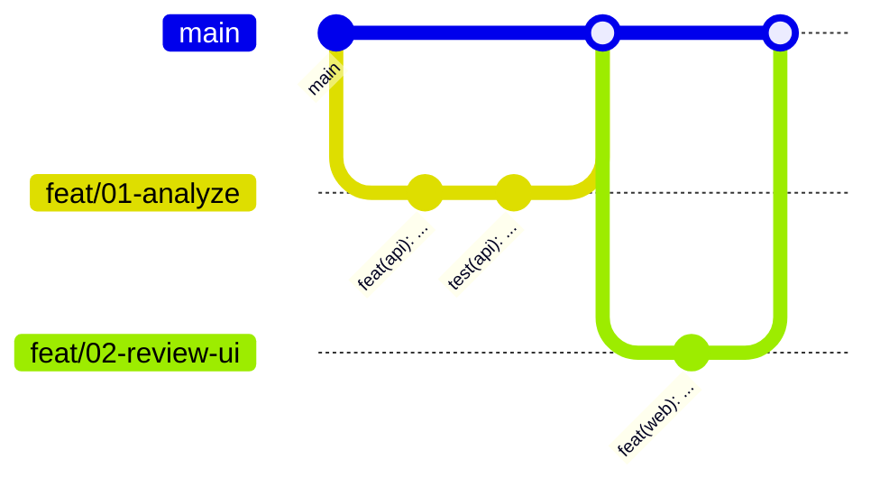

# Git workflow (trunk-based)

`main` is the trunk: always deployable, because the CDK Pipeline deploys every merge.



## Rules

1. Branch from current `main`: `<type>/<NN>-<slug>` (`NN` = spec number,
   `00` for harness/repo work). Lives hours, not days.
2. Never commit or push to `main`; never force-push a shared branch.
3. Atomic [Conventional Commits](../.agents/skills/commit/SKILL.md). No AI attribution.
4. PR from the [template](../.github/pull_request_template.md) with its gates;
   **Rebase and merge** to keep every commit; delete the branch.
5. Parallel lanes use git worktrees, one per spec:
   ```sh
   git worktree add ../GhostStock-web -b feat/02-web-shell main
   ```

## Gates (git-native, every tool and human)

Enable once per clone:
```sh
git config core.hooksPath .agents/hooks/git
```

| Hook | Enforces |
| --- | --- |
| `pre-commit` | No commits on `main`; secret scan of staged files |
| `commit-msg` | Conventional header; strips attribution trailers; ADR gate |
| `pre-push` | No push to `main` |

Server side: GitHub branch protection on `main` requires a PR. A failing gate is fixed
at its cause, never bypassed with `--no-verify`.
