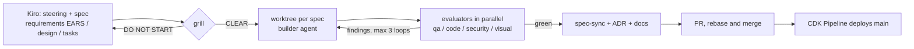

# Spec-Driven Development workflow

Kiro writes the contract; Claude Code challenges it, builds it and reviews it; the
spec and the docs stay true to what ships.

## Specs

| Spec | Lane | Blocks |
| --- | --- | --- |
| `00-contracts` | contracts | everything |
| `01-api-bedrock` | api | integration |
| `02-web` | web | integration |
| `03-infra-pipeline` | infra | first deploy |

After `00-contracts` merges, 01, 02 and 03 run in parallel worktrees. No two specs own
the same paths; contract changes go only through `00-contracts`.

## Loop rules

- The builder never certifies its own work.
- generate -> evaluate -> fix, at most 3 rounds; then stop and escalate with evidence.
- Reality diverges from the spec -> update the spec first (`spec-sync`), then code.
